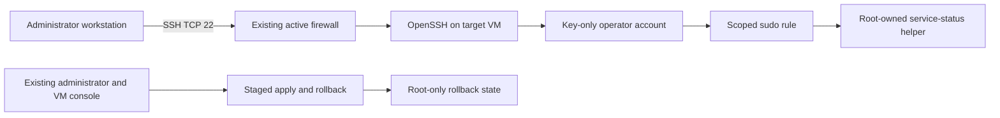

# Secure Linux Baseline

## Project Overview

Secure Linux Baseline is a staged administration lab for Ubuntu Server 24.04 LTS
and Rocky Linux 9. It creates a key-only operator account, a narrow sudo rule,
an SSH hardening drop-in, and a source-limited SSH firewall rule.

The default workflow renders files for review. Changing a server requires a
separate root command and an explicit disposable-VM confirmation. Account setup,
SSH hardening, and firewall changes are separate steps so that access can be
checked between changes.

## Project Objectives

- Use the correct account, SSH service, and firewall tools for each target OS.
- Give an operator only the sudo permission needed to inspect service status.
- Require a tested SSH key session before changing SSH authentication settings.
- Validate SSH and sudo configuration before using it.
- Keep existing firewall rules and system security controls intact.
- Record root-only rollback state for each applied stage.
- Separate configuration tests from full remote-access verification.

## Real-World Use Case

A support operator needs to log in with an SSH key and check basic service
status without receiving a root shell. An administrator needs to introduce the
account and security settings without changing several access controls at once.

This lab demonstrates that workflow on a disposable VM. It is not a complete
production hardening standard or an automatic migration tool for an existing
server.

## Technologies Used

| Component | Ubuntu target | Rocky target |
| --- | --- | --- |
| Operating system | Ubuntu Server 24.04 LTS | Rocky Linux 9 |
| Package manager | APT | DNF |
| SSH package and service | `openssh-server`, `ssh` | `openssh-server`, `sshd` |
| Firewall | UFW | firewalld |
| Mandatory access control | Existing AppArmor policy is preserved | Existing SELinux policy is preserved |
| Account and privilege tools | `useradd`, `sudo`, `visudo` | `useradd`, `sudo`, `visudo` |
| Service manager | systemd | systemd |

Scripts use Bash. ShellCheck and automated tests support development. See
[testing](docs/testing.md) for the versions and checks actually executed.

## System Requirements

Use one disposable target VM and an administrator workstation with an SSH client.
Keep the VM console available for recovery. Use an existing nonroot recovery
administrator to run apply and rollback commands; the new operator cannot run
them. Before hardening, independently test the recovery administrator's SSH key
login and full sudo access. It must be different from the new operator and belong
to Ubuntu's `sudo` group or Rocky's `wheel` group. If only root SSH access works,
stop and prepare a tested nonroot recovery administrator first.

The target needs systemd, OpenSSH server, sudo, and its OS-specific firewall. The
firewall phase requires an already active firewall. The renderer can run without
root and does not need a target service running.

An isolated lab network is recommended. Documentation addresses such as
`192.0.2.10` are examples, not a network that the scripts create. Use your actual
VM address and the source range the VM sees for your workstation.

## Architecture



The operator does not join Ubuntu's `sudo` group or Rocky's `wheel` group. Its
passwordless sudo permission runs only the root-owned status helper, not an
arbitrary command. See [architecture](docs/architecture.md).

## Project Structure

```text
secure-linux-baseline/
  scripts/
    baseline.sh
    apply-baseline.sh
    check-ssh-layout.sh
  tests/
  docs/
    architecture.md
    installation.md
    configuration.md
    troubleshooting.md
    testing.md
  .github/workflows/
  .editorconfig
  .gitignore
  LICENSE
  Makefile
  README.md
```

## Installation

Before publication, use the local project directory. Clone commands for the
planned GitHub repository are listed in [installation](docs/installation.md) and
are usable only after it exists.

Install prerequisites on the chosen disposable VM, review the scripts, and keep
your existing administrator session open. Do not run an apply phase from an
untested SSH connection.

## Configuration

Choose a new operator name, one Ed25519 public key, the target OS, and a narrow
IPv4 management source range. The public key must be a public-key file, not a
private key.

Example render command for Ubuntu:

```bash
bash scripts/baseline.sh render \
  --os ubuntu \
  --admin-user lab-operator \
  --public-key "$HOME/.ssh/secure-linux-baseline.pub" \
  --admin-cidr 192.0.2.0/24 \
  --output "$HOME/baseline-bundle"
```

The output directory must be new. Replace the example source range before any
apply command. Use `--os rocky` for Rocky Linux 9. The SSH port remains `22`.
See [configuration](docs/configuration.md) for the files and input rules.

## Usage

Work in phases. Review the bundle first. Run the following target-side commands
only on the disposable VM, from an existing administrator account.

Create the account and scoped sudo access without changing SSH or the firewall:

```bash
sudo bash scripts/apply-baseline.sh bootstrap \
  --bundle "$HOME/baseline-bundle" \
  --confirm-disposable-vm
```

From a second workstation terminal, log in as the operator using its key. Verify
that the intended status helper works. Keep the original session and console
available. Independently test a key session and full sudo access for the existing
nonroot recovery administrator. Only after both tests succeed, harden SSH:

```bash
read -r -p 'Existing tested nonroot recovery administrator: ' EXISTING_ADMIN
sudo bash scripts/apply-baseline.sh harden \
  --bundle "$HOME/baseline-bundle" \
  --confirm-disposable-vm \
  --confirm-key-session lab-operator \
  --confirm-recovery-admin "$EXISTING_ADMIN"
```

Test a fresh key session again. Then, after reviewing the existing active
firewall and the real management source range, add the firewall rule:

```bash
sudo bash scripts/apply-baseline.sh firewall \
  --bundle "$HOME/baseline-bundle" \
  --confirm-disposable-vm \
  --confirm-firewall
```

The two confirmation flags record human assertions. They do not prove that a
remote login or sudo command succeeded. The firewall phase adds a rule; it does not remove
broader existing allow rules. See the full [installation and recovery
sequence](docs/installation.md) before applying anything.

## Testing and Verification

Run repository checks from the project root:

```bash
make check
```

All 31 automated tests, syntax checks for the three scripts, and ShellCheck
passed in Debian 13 and an Ubuntu 24.04.5 LTS container. Both rendered bundles also
passed native Ubuntu SSH and sudo syntax checks. Rocky native validation was
blocked by package-mirror access; it is not claimed as passed.

The [test record](docs/testing.md) separates these results from unexecuted VM
checks. Full validation needs new SSH sessions, allowed and denied access tests,
sudo checks, service logs, and rollback on each target OS.

## Expected Results

After a verified VM run:

- The operator can log in with its Ed25519 key.
- The operator can run `sudo -n /usr/local/sbin/baseline-service-status`.
- A general root command such as `sudo -n id` is denied for the operator.
- New SSH sessions use the hardened configuration.
- The existing firewall contains the rendered source-limited SSH rule.
- Each applied phase has root-only recovery state.

These are acceptance goals, not claims that remote VM tests have passed. A
source-limited allow rule does not deny other sources if another existing rule
still permits them.

## Troubleshooting

Do not close the existing administrator session during diagnosis. Use the VM
console if a new SSH connection fails. Check SSH syntax, effective settings,
service logs, file ownership, and the firewall before changing another control.

See [troubleshooting](docs/troubleshooting.md) for OS-specific commands.

## Security Considerations

Keep private keys on the workstation. Never add private keys, passwords, real
host details, rendered bundles, or root rollback state to Git. Use a narrow
management source range and verify the address after NAT or VPN routing.

The scripts do not disable or change AppArmor or SELinux policy. Check the real
VM's expected enforcing state. Rocky key files receive the expected SELinux file
context. Do not disable these controls or the firewall to hide a configuration
problem.

The operator account has limited status access, not general administrator
rights. The helper is root-owned. Audit existing users, groups, sudo rules, SSH
settings, and firewall rules separately.

## Limitations

- Apply and rollback are lab operations for disposable systemd VMs.
- The supported targets are Ubuntu Server 24.04 LTS and Rocky Linux 9.
- The lab uses one operator, one Ed25519 public key, IPv4 source filtering, and
  SSH port 22.
- Existing operator names or managed-file conflicts are rejected rather than
  overwritten automatically.
- Adding a firewall rule does not audit or remove broader rules, change default
  policies, or establish full network isolation.
- Configuration validation cannot prove remote access or detect every external
  routing problem.
- Automatic hardening refuses `Match` blocks, unsupported configuration symlinks, and
  unsupported custom includes; these need a separate configuration review.
- Rollback locks and expires a newly created operator and sets a no-login shell.
  It keeps the account and home for review instead of deleting user data.
- This project does not implement a full CIS benchmark, patch management,
  intrusion detection, or central identity service.

## Future Improvements

- Add verified full-VM runs for both target operating systems.
- Add an explicit, reviewed workflow for migrating broader firewall rules.
- Consider a separate Ansible project for repeated server configuration.
- Document operator key rotation with a verified recovery path.

These are future items, not implemented features.

## License

This project uses the [MIT License](LICENSE).
