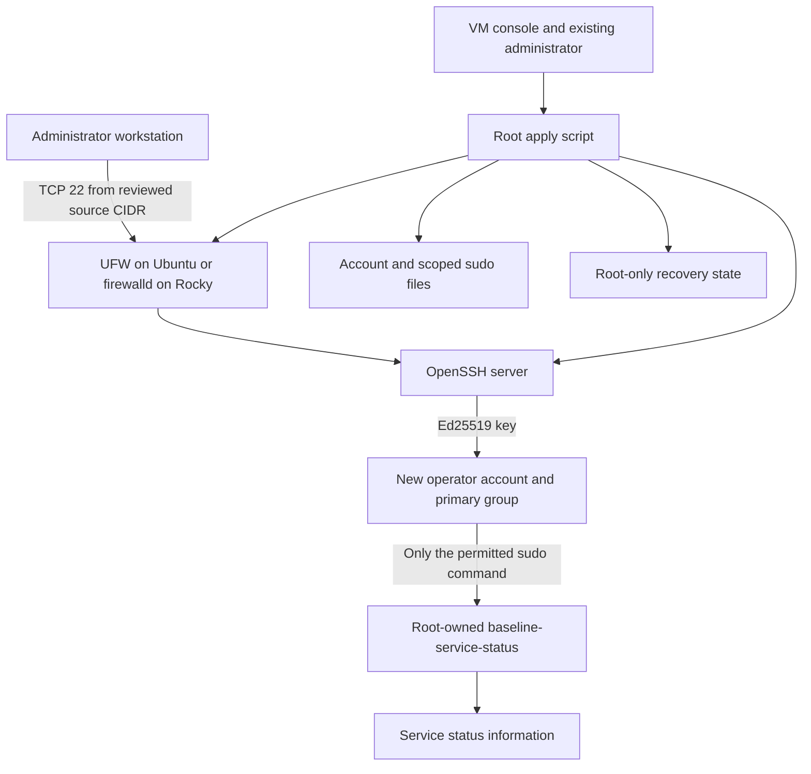

# Architecture and Access Model

The lab has one target VM and an administrator workstation. No application or
public web service is involved. The only inbound service addressed by this
project is SSH on TCP port 22.

## Trust boundaries

- The workstation holds the private key. Only its public key enters the bundle.
- The new operator has a normal account and a narrow passwordless sudo command.
  It has no general root shell and does not join `sudo` or `wheel`.
- A distinct existing nonroot recovery administrator runs apply and rollback
  from a reviewed checkout. Its key login and full sudo access must be tested
  independently before hardening disables root SSH access.
- Rendered files are configuration input. Review and protect them before use.
- Recovery state is stored under `/var/lib/secure-linux-baseline` with root-only
  access. It is not a Git artifact or a public test fixture.

## Stages

### Render

The unprivileged renderer validates the inputs and creates a new bundle directory.
It does not create an account, change a service, or run a firewall command on the
target.

### Bootstrap

The root apply script checks the target OS and conflicts. It creates the new
operator and its key files, installs the status helper, and installs the scoped
sudo rule. SSH and firewall settings are not changed in this stage.

The operator must then prove key access in a separate SSH session. The current
administrator connection and VM console remain available.

### Harden

The administrator confirms separate key sessions for the operator and for an
existing nonroot recovery administrator with full sudo access. The script checks
that the recovery account is different and belongs to the target's administrator
group. This cannot prove a successful remote key login or the exact sudo scope.

The script installs the SSH drop-in, checks the complete SSH configuration and
effective settings, and reloads the target OS's SSH service. A validation or
reload failure restores the managed file. `Match` blocks, SSH configuration
symlinks outside the supported vendor policy path, and unsupported custom
includes are refused rather than rewritten. Rocky's official crypto-policy
include remains active after trust and content checks.

The confirmation flag is a human gate, not an automated remote login check.
Another fresh key session is required after the reload.

### Firewall

The firewall must already be active. The script adds a source-limited TCP 22
allow rule. It does not enable a firewall, replace its default policy, remove
other rules, or migrate between firewall managers.

Existing broad rules can still allow SSH from other sources. A denied-source
test and a rule review are required before claiming source restriction.

### Rollback

Each phase creates its own state directory. Roll back applied phases in reverse
order, using the exact state path recorded by each phase. Managed files are
restored and the phase's own firewall change is reversed. A new operator account
is locked and expired and receives a no-login shell. It is not deleted; its home
remains available for review.

Rollback is a recovery tool for changes owned by this lab. It is not a backup of
the whole VM and cannot undo unrelated administrator changes.

## Operating-system differences

| Area | Ubuntu Server 24.04 LTS | Rocky Linux 9 |
| --- | --- | --- |
| Package manager | APT | DNF |
| SSH service | `ssh` | `sshd` |
| Firewall manager | UFW | firewalld |
| Mandatory access control | AppArmor policy is not changed | SELinux policy is not changed; key file contexts are restored |

The scripts do not assume these tools and service names are interchangeable.

## Failure handling

A rendered configuration is not proof of a working service. The workflow checks
syntax and effective SSH settings before reload, but the administrator must
still test the real network path and key login. Console access is the recovery
channel when SSH or routing is unavailable.

Full acceptance includes positive and negative access checks, scoped sudo,
service logs, firewall inspection, and a rollback exercise. Containers can check
many configuration files, but they do not prove a full VM access workflow.
